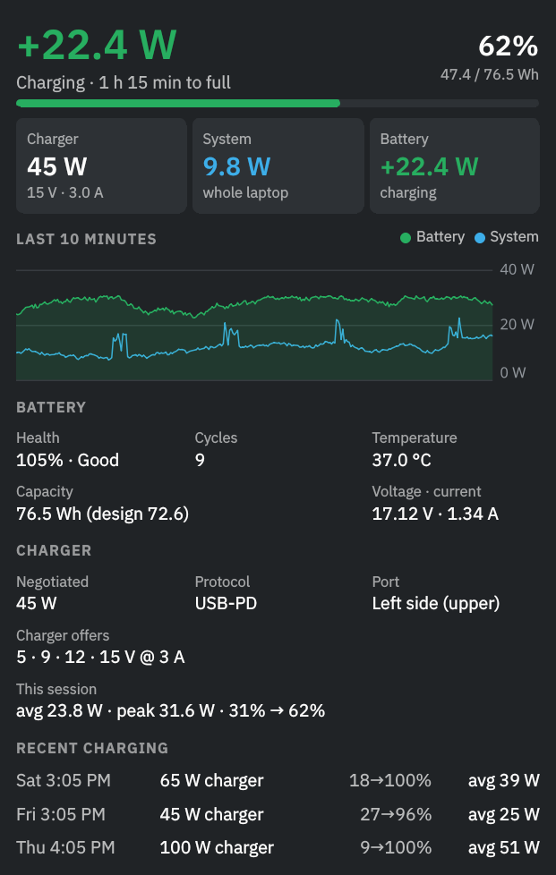

# Watt Meter

A KDE Plasma 6 panel widget that shows live battery charge/discharge wattage,
whole-system power draw, USB-PD charger details and battery health.

<p align="center"></p>
<p align="center"></p>

The panel shows a bolt and the live rate (`+6.1 W` while charging, `−8.3 W` on battery).
Next to the bolt, an icon shows the active power profile when it isn't Balanced (the
same icons as Plasma's battery applet), and a thin bar underneath shows the charge
level: green while charging, red at 20% or less on battery. The readout keeps a
fixed width, so it doesn't resize when the icon appears or the number changes.

<p align="center"></p>

Both can be changed in the widget's settings (**Power profile icon:** Never / When not
Balanced / Always, and **Show charge level bar under the readout**).

Click it for a popup with:

- The live battery rate, time to full or time left, and charge level
- The active power profile
- Tiles for the charger (rated W, negotiated V × A), the system draw and the battery rate
- A graph of battery and system wattage over the last 10 minutes
- Battery health, cycle count, temperature, capacity vs. design, and voltage/current
- Charger details: negotiated power, protocol, port and offered voltages, plus this session's average and peak rate
- Recent charging sessions with average charge rate

## Install

```sh
git clone https://github.com/wiebelhaus/plasma-wattmeter.git ~/.local/share/plasma/plasmoids/local.wattmeter
```

Then right-click the panel → **Add or Manage Widgets** → **Watt Meter**.
After changing files, restart Plasma: `kquitapp6 plasmashell && kstart plasmashell`.

## System power draw (optional)

The System figure comes from the Intel RAPL `psys` energy counter, which is
root-only by default. To make it readable:

```sh
echo 'ACTION=="add", SUBSYSTEM=="powercap", ATTR{name}=="psys", RUN+="/bin/chmod 0444 /sys%p/energy_uj"' \
  | sudo tee /etc/udev/rules.d/90-rapl-psys-read.rules
```

Reboot, or apply it immediately with `sudo chmod 0444 /sys/class/powercap/intel-rapl:1/energy_uj`.
Without it, the System figure is shown only while on battery.
RAPL counters are restricted because the per-core and package counters can leak
information through timing side channels. `psys` measures the whole platform
and is coarser, but making it readable is still a trade-off.

## How it works

`contents/code/read.sh` reads `/sys/class/power_supply`, `/sys/class/typec`,
`/sys/class/usb_power_delivery`, hwmon and powercap, and prints one JSON snapshot.
The widget runs it every 2 seconds (configurable).

Developed on a Framework Laptop 13. Other laptops should work wherever the
kernel exposes the same sysfs data.
